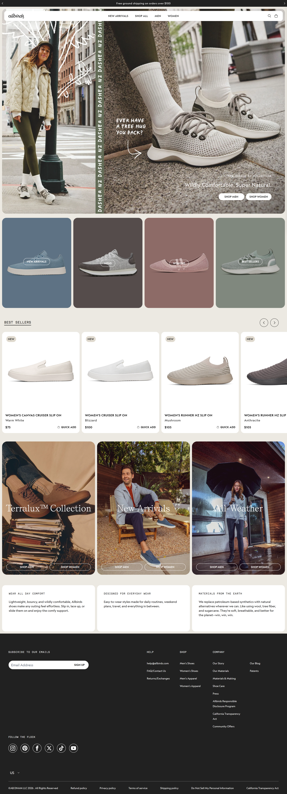

# Assignment 2 — Responsive E-commerce Website

## Project Overview

This project recreates the layout and visual style of the Allbirds e-commerce website as part of the Web Technologies course. It focuses on HTML structure, CSS styling, Bootstrap layout utilities, and responsive design.

The project contains a homepage/product listing page and one static product detail page. The product detail page is for the **Women's Cruiser Slip On in Blizzard**. All eight Best Sellers product-title links on the homepage lead to this same `product.html` page, as required for this version of the assignment.

## Reference Website

- **Name:** Allbirds
- **URL:** https://www.allbirds.com/
- **Reference screenshot:** `screenshots/reference-site.png`



## Pages and Features

### Homepage — `index.html`

- Logo and responsive navigation bar
- Announcement bar and hero campaign section
- Horizontally scrollable category cards
- Best Sellers section containing eight product cards
- Featured cards and informational sections
- Footer with shop, help, company, and social links
- All eight Best Sellers product-title links open the same `product.html` page

### Product Detail Page — `product.html`

- Product image, name, price, and colour
- Product description and feature list
- Size and quantity selectors
- Static Add to Cart button
- Link back to the homepage / Best Sellers section
- Consistent footer styling

The product page shows one fixed product. The buttons and selectors are interface elements only; no order, cart, or checkout is processed.

## Technologies Used

- **HTML5** — page structure and content
- **CSS3** — custom styling and responsive rules
- **Bootstrap 5.3.3** — responsive grid, navbar, spacing, and layout utilities
- **Bootstrap Icons** — interface icons
- **Google Fonts** — Figtree and Newsreader typography
- **JavaScript** — small homepage interactions, including announcement rotation, mobile category-card behaviour, and Best Sellers arrow controls

## Responsive Testing

Check the homepage and product detail page at the following viewport widths:

| Device  | Viewport width |
| ------- | -------------: |
| Mobile  |         375 px |
| Tablet  |         768 px |
| Desktop |        1440 px |

The completion PDF should contain screenshots of both pages at all three widths.

## Project Structure

```text
assignment-2/
├── index.html
├── product.html
├── style.css
├── script.js
├── README.md
├── completion.pdf
├── screenshots/
│   ├── reference-site.png
│   ├── homepage-mobile.png
│   ├── homepage-tablet.png
│   ├── homepage-desktop.png
│   ├── product-mobile.png
│   ├── product-tablet.png
│   └── product-desktop.png
└── images/
    ├── allbirds-logo.png
    ├── hero-campaign.png
    ├── hero-campaign-mobile.png
    ├── Best Sellers/
    ├── Cards/
    └── Featured Cards/
```

The `screenshots/` folder and `completion.pdf` are submission items to add after capturing the evidence; they may not exist in the repository yet.

## How to Run

1. Open the `assignment-2` folder in Visual Studio Code.
2. Open `index.html` using the Live Server extension, or serve the folder with a local web server.
3. Click a Best Sellers product title to open `product.html`.
4. Use the browser's responsive/device toolbar to test mobile, tablet, and desktop widths.

## Scope and Limitations

This is a front-end layout assignment. The shopping bag, Add to Cart button, size selector, quantity selector, search button, and email signup are not connected to a shopping cart or backend. The product detail page is intentionally static and displays one product.

## Completion Evidence

The accompanying `completion.pdf` should include the Allbirds reference screenshot and responsive screenshots for the homepage and product page at mobile, tablet, and desktop widths.
